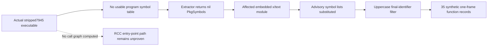

The39 records per shipping executable are **stripped-binary module fallback results**, not39 entry-point call traces or proof of35 linked vulnerable functions. Static inspection of all eight actual7945 executables establishes the scanner's missing-symbol condition. Govulncheckv1.1.4 then substitutes the affected advisory's symbol list and emits one-frame function-shaped records. This reconciles these results with the earlier source scans'0 call-traced findings on unchanged Go inputs. **GO-2026-5970 and GO-2026-6629 remain present, unremediated dependency advisories requiring explicit security disposition; neither exploitability nor a clean dependency graph is established.**

Exact shipping source: `7945f956b428359928908a9f42e36417b113dafd`, tree `49baf943b9d64ef79af56ec8f34eebe0385477b1`. Source was read through immutable Git objects in `/workspace/rcc`; no checkout/head attribution was substituted. This lane executed no scanner, build, application, test, vulnerability probe, source fix, or GitHub mutation. It did not alter release/publication HOLD.

| Supplied advisory | Actual condition from retained OSV | Static disposition |
| --- | --- | --- |
| GO-2026-5970 / CVE-2026-56852 | `norm.Iter` can loop forever on invalid UTF-8. Embedded `golang.org/x/text v0.28.0`, fixed0.39.0. | `needs_review`: affected module exists; prior source import graph contains norm, but no root call trace or supported malformed-input boundary is proven. |
| GO-2026-6629 / CVE-2026-56851 | Nickname profile can panic on crafted input transformed into a short destination buffer. Same affected module, fixed0.41.0. | `needs_review`: affected module exists; prior root source scan classified precis as module-only. No imported supported Nickname caller, short-buffer condition, or root trace is proven. |

Each raw stream has26 GO5970 records and13 GO6629 records: one module, one package and24 function shapes for norm; one module, one package and11 function shapes for precis. Across eight executables this is312 retained scanner messages, including280 function shapes, representing two advisory IDs. Every trace has exactly one x/text frame with no caller or source position. The198 unfiltered OSV objects in each stream are database input, not198 affected findings. `raw-findings-preserved.json` retains every message in original per-stream order; `triage-finding-v0.json` provides one `needs_review` result per supplied message without dropping duplicate-looking records. Norm's imported-package evidence ranks before module-only precis; equivalent records retain input order. There are no confirmed exploitability findings and no `not_actionable` closure.

The exact checker is govulncheckv1.1.4, recorded SHA256 `119a9cb89999d79c6932fe65e52f02b7c53276dd0f511da0085be5773f417fe3`, built with Go1.26.9. Actual binary JSON config reports symbol/binary mode, DB `https://vuln.go.dev`, last modified2026-10-08T22:31:09Z. All eight completed invocations used `-mode=binary -json`, exited0, and retained findings. JSON exit0 is processing completion: the JSON handler encodes messages without a findings-status flush (`internal/govulncheck/jsonhandler.go:15–48`; `internal/scan/run.go:40–76,155–159`). It is not a zero-vulnerability result.

The scanner source is independently pinned to upstream v1.1.4 commit `d1f380186385b4f64e00313f31743df8e4b89a77`; selected actual bytes match its complete Git tree's blob identities. The key implementation is [binary.go](https://github.com/golang/vuln/blob/d1f380186385b4f64e00313f31743df8e4b89a77/internal/vulncheck/binary.go#L46-L130): lines46–48 explicitly do not compute call graphs, lines107–111 choose all known advisory symbols when `PkgSymbols` is empty, and lines178–206 construct that inventory at module precision. [additions_scan.go:86–90](https://github.com/golang/vuln/blob/d1f380186385b4f64e00313f31743df8e4b89a77/internal/buildinfo/additions_scan.go#L86-L90) returns nil symbol information on `ErrNoSymbols`. [witness.go:396–448](https://github.com/golang/vuln/blob/d1f380186385b4f64e00313f31743df8e4b89a77/internal/vulncheck/witness.go#L396-L448) creates each synthetic one-frame trace and omits symbols whose final identifier is lowercase when uppercase identifiers exist. Therefore `nextComposed` disappears, while exported-shaped methods on unexported receivers remain. Every actual stream exactly matches this24/25norm +11/11precis advisory-derived set.



All eight actual binary SHA256/size values independently match the accepted asset verification and retained scan summary. Actual Go metadata hashes match and record Go1.26.9, exact7945 revision, clean VCS and `-ldflags=-s`. The underlying metadata conditions are independently observed, not inferred from file size:

| Actual targets | Symbol metadata | Source mapping to fallback |
| --- | --- | --- |
| RCC + RCCRemote Linuxamd64 |16 ELF sections each; no `SHT_SYMTAB`. | `additions_buildinfo.go:27–31,42–57` maps `elf.ErrNoSymbols` to `ErrNoSymbols`. |
| RCC + RCCRemote Windowsamd64 |COFF symbol count0 in both actual PE headers. | Same source:142–147 returns `ErrNoSymbols` for zero symbols. |
| RCC macOSamd64/arm64 |141/144 nlist entries; `runtime.main` absent. | Same source:209–221 detects stripped Mach-O by missing program symbol. |
| RCCRemote macOSamd64/arm64 |109/112 nlist entries; `runtime.main` absent. | Same explicit Mach-O condition. |

This does not prove those functions are absent from machine code: Go pclntab/inlined code may remain even when the scanner cannot recover its required symbol information. It proves the recorded findings were produced at fallback precision and cannot establish linked function presence, parameter values or entry-point reachability.

Earlier source evidence remains **performed on727**, not a newly performed7945 scan. The same checker/SHA/Go1.26.9 ran `-show traces,verbose ./...` against29 root packages on Linuxamd64(CGO1), macOSamd64/arm64(CGO0), and Windowsamd64(CGO0), each exit0 and0 symbol-call findings. Norm was an imported-package advisory; precis was module-only. A separate corrected `-C cmd -scan=module -show verbose` scan exited3 for both module advisories; its preceding root-pattern error remains preserved. Source mode builds a call graph and intersects entry-point reachability (`internal/vulncheck/source.go:40–42,98–110,145–182`); binary mode does not.

Independent immutable Git comparison verifies429 Go files, four `go.mod`/`go.sum` files and three embedded `blobs/assets`/`blobs/docs` inputs have identical mode/type/blob/size between727 and7945. The independently recalculated peer manifest hashes are respectively `468fd4e039623cbb06652e9784f4f2156ae15730cd8fad1ebe890f65e701a476`, `de31468c47cef10971335b68769bae3ebc32ed95054ff83b4c9c033f2cb1434e`, and `ae4b59c1d694fa2451853846bbe443bc9535cb95a71d0d7a183b926e65f830ad`. Their peer encoding uses literal backslash-zero/backslash-n, explicitly recorded in the proof. Documentation/workflow/release-helper differences are outside this input-equivalence scope. Thus there is no source/dependency-change explanation for new exposure in7945 within this projection. The previous scan's DB timestamp was not serialized, and Linux sourceCGO1 differs from shippedCGO0; equivalent inputs do not turn the previous run into fresh7945/build-identical execution.

The smallest reviewed product/dependency surface supports that interpretation. Exact7945 tracked Go sources contain no direct x/text, `norm`, `precis` or `NeuterAccents` references (expected `git grep` no-match exit1 preserved). RCC's config path is `cmd/root.go:144–156` → `xviper/wrapper.go:75–78` → `viper.New`/`ReadInConfig`. Upstream version-bound Viper1.21.0 `viper.go:194–199` selects `afero.NewOsFs`; lines1518–1537 read/unmarshal configuration. Afero1.15.0 `os.go:54–61` opens through `os.Open`. Its separate `util.go:160–163` helper `NeuterAccents` imports and uses `norm.NFD`/`norm.NFC` through a transformer; no current RCC caller was established. That helper explains an imported dependency surface without supplying an RCC source-to-sink path. These selected upstream files are commit/tag/blob-bound; this lane did not recompute complete upstream module ZIP checksums. It did not trace every transitive library implementation or prove all alternate callers safe.

No root/scoped `SECURITY.md` exists in the exact7945 Git tree. `AGENTS.md` describes the shipped CLI and `docs/agent-boundaries.md` defines read/release authority; neither establishes a trusted-input exclusion for these advisories. A supported lower-trust actor's malformed bytes, a reachable affected call, and the advisory-specific buffer/profile state remain material gaps. Therefore `needs_review` is appropriate: source-call counterevidence and fallback semantics prevent confirmation, while incomplete boundary/alternate-path proof prevents blanket dismissal. The skill's shared security-guidance/static-assessment resources were unavailable through the supplied cloud accessor; the result-contract and actual repository guidance were read, and the limitation is retained.

The initial shipping scan's aggregate-output cap failure remains an execution incident: first four streams completed, then the fifth process was killed before producing output (`-9`) after the initial2MiB check had already been exceeded. Only the remaining four were run in the separately authorized successor; all eight accepted streams total4,882,949B under that successor's8MiB envelope. No target was executed in those scans. This lane did not repeat them. Any earlier owner-summary wording that says all traces contain only module/version, or that these prove actual matching binary symbols, is contradicted by the raw frames and verified fallback conditions; this report is additive and does not edit that owner's files.

The15 dashboard reports (1critical/6high/4moderate/4low) remain a distinct uninventoryed input: the authorized Dependabot REST response was403, so package/alias/severity mapping and per-alert disposition are unavailable. They cannot be cleared or equated with these two Go advisories. The seven reported inherited vet diagnostics are also distinct; no fresh vet ran and no individual vet finding is resolved here. The separate `.dagger` module remains outside the root-source call-reachability claim. Native/Robot/test passes establish their tested workloads, not malformed-input advisory safety.

Root decision proposed: review the actual fallback proof and unchanged input projection; classify these eight binary scans as **completed with affected-module advisory records, not demonstrated call reachability**. Preserve both advisories as unremediated and obtain explicit disposition for the supported shipping boundary. Do not label them exploitable merely because of function-shaped JSON, close them merely because the earlier source scan was0, or waive the inaccessible dashboard inventory. An operator/security owner must decide whether the static call/boundary evidence is sufficient for documented residual-risk acceptance or requires an authorized dependency correction with fresh source/native gates. This lane grants neither release approval nor a source-change authorization.

If root needs one additional, meaningful source validation, propose **one Linuxamd64 CGO0 source-mode JSON scan** of exact7945's two shipping mains, with the existing Go1.26.9/checker and cached dependencies; no dependency installation and no timed benchmark. After explicit source/cache ownership and resource admission, the command is:

```sh
env PATH=/workspace/work/rcc-swarm/tools/go1.26.9/bin:$PATH GOTOOLCHAIN=local GOWORK=off GOOS=linux GOARCH=amd64 CGO_ENABLED=0 GOFLAGS=-mod=readonly GOPROXY=off GOSUMDB=off /workspace/work/rcc-swarm/tools/govulncheck-go1.26.9 -mode=source -json ./cmd/rcc ./cmd/rccremote
```

Run directory must be a root-admitted exact7945 source snapshot or independently proved identical shipping-input projection, not a falsely relabeled head. Required bounds: one invocation,120s wall,512MiB sampled whole-tree RSS,2MiB retained output,≤10MiB new cache/temp plus any separately approved source snapshot, global free≥2,684,354,560B throughout. Cached module/export availability and exclusive cache ownership must be preflighted; missing cache, capacity, RSS or time breaches preserve a stopped result, with no download, automatic retry, cap increase or production mutation. Gate on parsed advisory/trace content, target/build/source/DB provenance and complete numeric status, not JSON exit0 alone. This is **proposed and unexecuted**; input equivalence plus the verified fallback may make repetition unnecessary after root review. No malformed-input PoC is proposed.

`static_evidence.py`'s final evidence derivation exited0 and independently validated all8actual binary hashes/metadata, all312 original messages, all8fallback conditions, the advisory-symbol filter and source projection. An initial inline fetch syntax failure and the first derivation's incorrect whole-file-versus-STDOUT hash assumption are preserved; the corrected parser matches all four original STDOUT payload hashes and retains each wrapped log hash. These were evidence-processing failures, not scanner/target reruns. `source-bound-proof.json`, raw inputs, per-input triage, selected immutable sources and completion manifest provide the concrete review record.

Documentation receipt: canonical guidance unchanged under this evidence-only authorization; durable learning is that stripped v1.1.4 binary findings can carry synthetic function frames at module precision. Exact tool source, actual shipping headers and raw streams support that proposed guidance. No stale source text was edited; supported malformed-input reachability, dashboard mapping and final shipping disposition remain unresolved.
